# Technical requirements and design

Use Python 3.10+ and the permitted starter parser and machine loader from `kirlib.py`. Parse into ordered basic blocks with typed operands. Track the entry block explicitly. Derive successors from each terminator and compute predecessors when a pass needs them. Reuse the kit's operand representation where practical and write a small deterministic KIR emitter.

```mermaid
flowchart LR
    A["KIR and machine configuration"] --> B["Parse KIR into ordered blocks"]
    B --> C["Simplify arithmetic and propagate copies"]
    C --> D["Simplify branches and remove unreachable blocks"]
    D --> E["Compute liveness and remove dead pure instructions"]
    E --> S["Prove bounded polynomial recurrences"]
    S --> F["Reuse registers and lay out blocks"]
    P["Optional edge counts"] --> F
    F --> R["Prove cross-iteration load/store reuse"]
    R --> T["Schedule blocks and double short loops"]
    T --> Q["Prove and exhaustively specialize finite domains"]
    Q --> G["Emit valid KIR"]
    G --> H["Offline validation and cycle measurement"]
```

| Pass | Initial approach | Safety condition |
|---|---|---|
| Constants and copies | Seed each block with exact facts from range analysis. Walk forward within each block to track literals and current value identities. | Keep an entry constant only when the reachable incoming paths agree. Read all source facts before changing the destination and resolve copies only while their values are held. |
| Redundant arithmetic | Key pure expressions by opcode and the current operand values. Canonicalize operand order only for commutative operations. | Reuse an earlier result only while it remains available in a register. Begin with arithmetic and comparisons. |
| Load reuse | Track reads and writes by address value within a block. Discard facts a store could overwrite. | An earlier access to the same address must have succeeded on every path that reaches the replacement. The recorded value must still be available. |
| Memory cleanup | Use signed ranges to prove addresses are in bounds. Drop unused loads and match overwritten stores within trap-free continuations. | Require addresses in 0 through 4095. Stop store matching at reads or volatile operations and preserve the store sequence on any trapping path. |
| Signed division and remainder | Propagate signed intervals through blocks and direct comparison edges. Reduce an exact divisor to cheaper arithmetic or an inline literal. | Prove the divisor is nonzero. Preserve signed rounding, the sign of the remainder, and 32-bit overflow. |
| Branches and reachability | Fold known conditions, invert comparisons with zero, and traverse the remaining edges from the entry block. | Inversion swaps both targets and requires a register that still holds the tested value. Remove blocks only when unreachable. |
| Conditional assignments | Replace a pair of copy or constant assignments with a select before their common successor. | The arms must have one incoming edge each, assign the same register, and contain no other operations. |
| Late jump cleanup | Bypass newly jump-only blocks after layout and return directly from jumps to return-only blocks. | Keep jump cycles and protect shared fallthrough chains. Retain the original return operand and all effects on the path. |
| Block merging | Remove a redundant jump and label from adjacent blocks after allocation and layout. | The target must have a single incoming edge and be adjacent in both source and output order. Preserve the instruction sequence and register names. |
| Loop hoisting | Move groups of invariant arithmetic from a simple loop body into its existing entry block. Limit the group to one result read by the remaining body. | The operations must be pure, their operands invariant, and their destinations defined once in the loop and read only later in the body. |
| Loop doubling | Let alternating copies of a short loop body share a taken back edge. Check machine register and cache capacity after layout. | Keep the first check and a check after each body copy. Require a sole-entry body and skip volatile operations. |
| Liveness and dead code | Compute live-out as the union of successor live-ins. Use a backward worklist and scan instructions in reverse to find dead definitions. | Delete only pure, non-trapping instructions whose destination is dead. Keep stores, volatile operations, and potential traps. |
| Fusion | Recognize nearby multiply-add and shift-add patterns. Check machine features and compare modeled costs. | The intermediate value must be removable, operands must still denote the same values, and the fused shift count must be a legal literal. |
| Register reuse | Assign a shared pool of register names to block-local definitions after liveness and fusion. Use the machine's register count and estimate reloads on short cycles that could still spill. | Reserve parameters, registers live at block boundaries, and registers used by volatile I/O. Read operands before freeing their names for new definitions. |
| Polynomial summations | Symbolically derive `a + p(i)` of degree at most three and emit bounded closed forms. | Require index zero, stride one, invariant bound 0–255, sole-entry body and return-only exit. Reject effects and unsupported carried state; prove additional signed bounds before moving a final modulus. |
| Scheduling | Greedily reorder blocks of at most 32 operations using register dependencies and critical paths, then compare modeled short paths. | Preserve RAW/WAR/WAW edges and effect order, keep terminators last, skip volatile blocks. For spilling programs, require bounded incoming/outgoing and repeated-cycle contexts to pass too; skip context explosion or budget exhaustion. |
| Rolling memory reuse | Track affine addresses through a bounded counting body and carry a later successful access into the next iteration. | Prove stride/address identity, initial preload bounds, and absence of aliasing stores before the load and after its supplier. Preserve effects; reject volatile bodies and added spills. |
| Finite specialization | Prove at most twelve original input bits affect a pure function, evaluate the entire domain, and compare decision-tree and packed-literal candidates. | Reject memory, more than two read parameters, unmasked original reads, any trapping or nonreturning representative, and budget exhaustion. Exhaustively verify generated candidates. |

Keep the local passes linear in the number of instructions where practical. Avoid tables indexed by the largest register number and full scans for each individual rewrite. Use stable iteration order and a deterministic work budget for optional expensive analyses. The original input is a fallback when it is valid for the selected machine. Handle unsupported fused opcodes deliberately if the input contract requires lowering them, and document the behavior before relying on that path.

The optimizer reads no benchmark inputs. `src/kiln.py` contains permitted organizer execution and timing code, with its upstream revision credited in the module and design. Finite specialization uses only source-derived representatives after proving the complete relevant domain. Scheduling uses structural paths, not test inputs. The offline runner invokes the independent official tools on original and optimized programs with identical inputs and machine settings. Use trace output to investigate instruction issue stalls, branch penalties, and register spill regressions.

The bounded portfolio adds a second level around this pipeline: original fallback, standard/finite output, and up to four alternative pass combinations. Bit synthesis uses word recurrence matching and symbolic GF(2) coefficients; the nested option combines natural-loop LICM with additive-loop collapse. Candidate timing uses 16 deterministic cases, explicit step budgets and bounded profile weights; transformation correctness remains independent of this empirical ranking. See DESIGN for exact caps.

The checksum alternative carries a common-modulus congruence invariant alongside original and candidate signed intervals. It normalizes canonical live-outs only on a unique normal exit, recomputes ranges and then uses ordinary cleanup/allocation. Mathematical no-wrap checks are separate from the word constant folder. It adds no new proof assumptions from timing cases.

A separate static-control candidate follows only exact constant decisions with word semantics, retaining unknown data computations and effects. It never reads RAM during proof. A second straight-line candidate uses fresh definitions and a bounded literal-load cache with store invalidation; normal liveness/allocation handles the resulting live ranges. See DESIGN for visit/output caps and rejection rules.

The control layer reparses fresh emitted KIR before ordinary cleanup: affine diamond conversion, proved min-bound/late-trap loops, pointer induction and checked four-copy loops. Original effects keep their iteration order. New candidates are compared against the existing portfolio winner in a second bounded round with additional zero/dense/alternating RAM patterns; functions without a qualifying recipe keep the preceding selection. Exact proof gates and budgets are in DESIGN and D-033/D-034.
