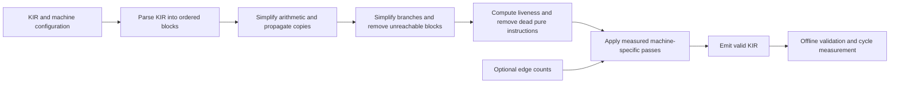

# Technical requirements and design

Use Python 3.10+ and the permitted starter parser and machine loader from `kirlib.py`. Parse into ordered basic blocks with typed operands. Track the entry block explicitly. Derive successors from each terminator and compute predecessors when a pass needs them. Reuse the kit's operand representation where practical and write a small deterministic KIR emitter.

| Pass | Initial approach | Safety condition |
|---|---|---|
| Constants and copies | Walk forward within each block. Track literals and current value identities. Read all source facts before changing the destination. | Resolve a copy only while a register still holds the copied value. Apply KIR's numeric rules. Start with unknown values at block boundaries. |
| Redundant arithmetic | Key pure expressions by opcode and the current operand values. Canonicalize operand order only for commutative operations. | Reuse an earlier result only while it remains available in a register. Begin with arithmetic and comparisons. |
| Load reuse | Track reads and writes by address value within a block. Discard facts a store could overwrite. | An earlier access to the same address must have succeeded on every path that reaches the replacement. The recorded value must still be available. |
| Reachability | Turn a known conditional branch into its chosen jump and traverse from the entry block. | Remove a block only if it is unreachable through the remaining explicit edges. |
| Liveness and dead code | Compute live-out as the union of successor live-ins. Use a backward worklist and scan instructions in reverse to find dead definitions. | Delete only pure, non-trapping instructions whose destination is dead. Keep stores, volatile operations, and potential traps. |
| Fusion | Recognize nearby multiply-add and shift-add patterns. Check machine features and compare modeled costs. | The intermediate value must be removable, operands must still denote the same values, and the fused shift count must be a legal literal. |
| Register reuse and scheduling | Consider block-local live ranges and schedule independent arithmetic in bounded regions after measuring the baseline. | Preserve values needed on outgoing edges and respect all read/write dependencies. Treat effects and possible traps as barriers in the initial scheduler. |

Keep the local passes linear in the number of instructions where practical. Avoid tables indexed by the largest register number and full scans for each individual rewrite. Use stable iteration order and a deterministic work budget for optional expensive analyses. The original input is a fallback when it is valid for the selected machine. Handle unsupported fused opcodes deliberately if the input contract requires lowering them, and document the behavior before relying on that path.

The optimizer reads no benchmark inputs. The offline runner invokes the independent official tools on original and optimized programs with identical inputs and machine settings. Use trace output to investigate instruction issue stalls, branch penalties, and register spill regressions.
